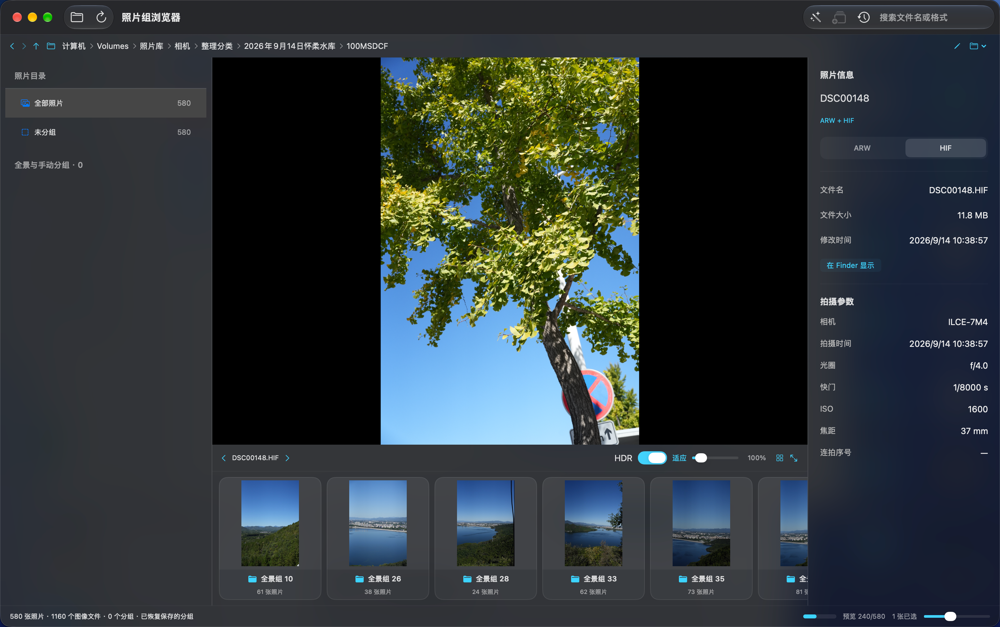
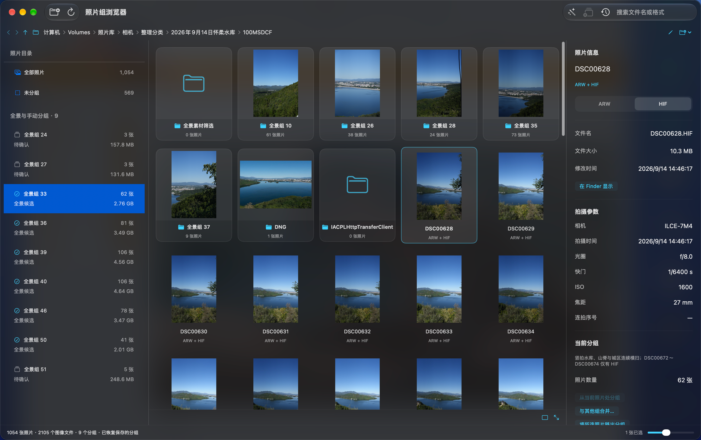

# 照片浏览器

简体中文 · [English](README.md)

## 下载与语言

从 [GitHub Releases](https://github.com/985860612/photo-browser/releases) 下载通用版，支持 macOS 14+ 的 Apple Silicon 和 Intel Mac。解压后放入 Applications。发布包采用临时签名，未经过 Apple 公证；如系统拦截，请核对来源后在“系统设置 → 隐私与安全”中选择“仍要打开”，也可自行从源码构建。

从 v0.4.12 起，应用在启动时及每隔 24 小时自动检查新版，也可通过“照片浏览器 → 检查更新…”手动检查。在“设置 → 软件更新”中可以关闭检查，或开启自动下载并在退出时安装。更新提示支持立即安装并重启、跳过版本和稍后提醒；文件移动、删除或视频导出尚未完成时会等待完成再重启。更新包及更新源均校验 Ed25519 签名。v0.4.11 及更早版本需要先手动升级一次才能获得自动更新功能；`swift run` 不启动更新。发布操作见[更新发布说明](docs/updates.md)。

界面随 macOS 首选语言显示简体中文或英文（Photo Browser），其他语言回退到英文。可在“系统设置 → 通用 → 语言与地区 → 应用程序”中为本应用选择语言，重新打开后生效。已有目录名、分组名称和用户填写的描述会保留。

大图和全屏的“RAW 优先”开关可选择优先预览 RAW 或 HIF/JPG。左右面板可独立收起，拖动左右分隔线可调整宽度，拖动底部缩略条上边界可调整高度；面板宽度、开关状态、缩略条高度及窗口大小在重开后恢复。

在 **设置 → 浏览 → 照片预览 → 显示对焦点** 中开启对焦点叠加，大图和全屏共用设置，更改立即生效并自动保存。包含 AF 区域元数据的 Canon EOS 照片（包括 CR2、原始 JPG）用红框显示已合焦点、黄框显示已选点；包含有效对焦位置与框大小的索尼照片（已实测 A7 IV ARW、原始 JPG）用青框显示记录位置，不将其标为已合焦。框随缩放、平移和 EXIF 旋转对齐；手动对焦、无有效记录和暂不支持的文件均有提示。仅在开启时读取信息，需要 ExifTool（`brew install exiftool`），不会改动原片。

macOS 原生照片浏览器，同名 RAW、HIF、JPG 合并成一次拍摄，全景按组浏览，确认后整组移动到新文件夹，支持撤销与中断恢复。

## 界面截图

以下为简体中文界面示例，应用也支持英文。

**大图浏览与目录缩略条**



**照片网格与全景分组信息**



## 使用

目录封面索引、照片数量和文件大小会保存在本机。重开或返回目录时先显示缓存，再后台检查变化；目录检查间隔为 5 分钟，完整大小统计默认缓存 6 小时。删除、移动和撤销会使相关目录及父目录缓存失效，⌘R 可强制刷新。悬停在卡片统计上可查看缓存时间和更新错误；首次进入没有缓存的目录仍需计算一次。

ISO 光盘镜像会与子文件夹一起显示为光盘卡片。双击卡片，或通过 ⌘O、⌘L 选择镜像文件，即可只读挂载并浏览其中的照片、视频和子目录，无需先解压整张光盘。只在打开时挂载，不会为了生成目录卡片提前读取镜像。镜像内禁用移动、删除和 Camera Raw 编辑入口，分组和预览缓存仍保存在本机。镜像根目录的“上一级”及“返回镜像所在目录”返回原 ISO 所在文件夹；路径栏“推出镜像”可卸载已打开的镜像。退出应用时会正常推出本应用挂载的镜像，遇到占用则提示，不强制推出其他程序的磁盘。重开后会重新加载上次的镜像及其子目录。

1. 打开“照片浏览器.app”，点击“打开目录”（⌘O）。点击顶部路径中的任一级文件夹即可跳转，⌘L 输入或粘贴路径，支持 `~/Pictures`。⌘[ / ⌘] 后退与前进、⌘↑ 上一级；“全部照片”视图在底部缩略条或网格开头显示子文件夹卡片，双击进入；路径栏菜单也可进入子目录。分组和“未分组”视图只显示对应照片。每次只扫描当前目录。
2. 同名格式只显示一个缩略图，大图底部的格式菜单及全屏格式按钮可切换 HIF/JPG、AVIF 与 RAW。支持 AVIF 缩略图、大图、全屏原图和 HDR 预览；同名 AVIF 与其他格式、XMP 合并为一次拍摄。
3. 左侧选择分组，网格显示组内全部照片。双击照片进入大图，左右键切换，⌘J 切换网格与大图。**空格进入全屏并解码原始分辨率图像**，空格或 Esc 退出；可切换同名格式、适应屏幕或按 100% 像素检查细节。普通 RAW 浏览使用相机内嵌 JPEG 加速；全屏 RAW 使用系统原图解码，解码失败会明确提示切换格式。系统 RAW 显示与 Camera Raw 显影可能不同。
4. ⌘ 点击多选、⇧ 点击连选；⇧＋左右方向键以起始照片为锚点延伸连续选择，反向按键收缩范围，普通左右键恢复单张切换。⌘G 手动成组；在右侧按当前照片拆分、合并到其他组、或移出所选照片。
5. 右键分组选择“重命名…”，名称会保存，移动整组时默认使用此名称作为文件夹名；原照片名保持不变。“移动整组到新文件夹…”列出目标位置、所有格式及 XMP 文件，选择存放位置并填写新文件夹名称后，点击“确认移动”才修改原文件位置；可通过移动记录撤销。目标文件夹必须是新目录。
6. “移动记录”可撤销，也可恢复因退出或连接中断而未完成的操作。遇到同名文件、文件变化或缺失会报告并停止。
7. 用 ⌘／⇧ 多选照片，右键选择“在 Camera Raw 中打开所选 N 张照片”，即可一起送入同一个胶片栏。每张照片优先取 RAW，否则取首选图片，同名 RAW 和 JPG 不会重复传入；“指定格式”子菜单仍只打开该文件。**实验性原生宿主**直接加载本机 Adobe Camera Raw 插件，不启动 Bridge 或 Photoshop。点击“完成”保存设置到实际照片或 XMP；“取消”放弃当前调整。关闭后核对目录变化并保留选择和分组。同时只允许一个编辑会话。本机已验证 Camera Raw 18.1.1、TIFF 和 Nikon D3S NEF，其他版本与格式可能不兼容。浏览器尚不能呈现 Adobe XMP 调色效果；像素导入未实现，HDR 合并尚未验证。参见[宿主实现与实验记录](docs/camera-raw-host-probe.md)。
8. 大图和全屏均支持触控板捏合缩放、双指/鼠标滚动平移、鼠标拖拽平移（触控手势让照片跟随手指，兼容自然滚动开关）、⌘或 Option＋滚轮缩放，双击切换适应屏幕与 100% 像素。空白目录页显示子文件夹封面与合并后的照片数量，双击卡片进入，自动隐藏空的照片信息栏。
9. 苹果键盘按 **⌫（Backspace / Delete）**，将选中照片的全部 RAW、HIF/JPG 和 XMP 移到当前目录下的 `_del` 文件夹；Fn＋⌫ 或独立前向 Delete 键同样可用。连续删除复用 `_del`，不会永久清除文件，可从“移动记录”恢复文件及原有分组。遇到同名文件会在整批移动前停止。输入文字时仍是普通退格；长按不会继续删除下一张，目录卡片不参与删除。

全景拼接：在 Camera Raw 的胶片栏中选中待拼接照片（⌘A 全选），按 **⌘⇧M**，使用上次的拼接设置直接生成全景，保存到原目录的 `-Pano.dng`。关闭编辑器回到浏览器后，当前目录会识别新文件。已用三张有重叠区域的 TIFF 验证生成 1278×510 DNG，浏览器能扫描并解码原始分辨率。⌘M 可以进入全景预览，但本机普通“Merge…”保存面板的系统服务连接失败，当前请使用已验证的 ⌘⇧M 流程。参见 [Adobe 全景说明](https://helpx.adobe.com/camera-raw/desktop/hdr-and-advanced-output/create-panoramas.html)和[快捷键](https://helpx.adobe.com/camera-raw/desktop/get-started/overview-and-setup/default-keyboard-shortcuts.html)。

带 GPS 的照片在右侧显示「拍摄位置」，包含经纬度及可用海拔。点击「在地图中打开」可跳转到苹果地图的对应坐标；没有有效 GPS 时隐藏位置区域，不根据文件名或相机型号推测位置。原始经纬度保持不变。优先读取照片的 GPSMapDatum 标记，识别 WGS-84、GCJ-02 或 BD-09；缺失或无法识别时使用「设置 → 照片坐标系 → 未识别时优先使用」（默认 WGS-84）。设置立即生效并持久保存，明确的照片标记始终优先。右侧显示采用的坐标系和判断来源；无法识别的原始标记也会保留显示。仅凭经纬度无法可靠识别坐标系，不根据坐标数值、文件名或相机型号猜测。系统地区为中国大陆（CN）时，打开地图前会联网核实地点所属地区；先按照片来源坐标系规范化，再为大陆底图生成 GCJ-02 坐标；国际底图使用 WGS-84。已是目标坐标系时保持原值，避免重复偏移。系统地区用作国内地图模式的判断依据；若实际地图服务与系统地区不一致，仍可能出现偏移。地区查询失败会显示错误，不猜测坐标。旧原图头部缓存会在原图可访问时补读一次坐标系标记，不重新生成缩略图；缺失 GPS 的结果也会缓存。照片浏览不会自动启动地图，只有点击按钮才调用 [苹果地图接口](https://developer.apple.com/documentation/mapkit/mkmapitem/openinmaps%28launchoptions%3A%29)。

## 视频播放与剪贴板

状态栏显示实际留在内存中的相邻大图就绪数。设置中可查看大图内存占用、缓存命中，以及排队、打开图像源、解码、GPU 绘制完成的耗时，保留本次运行最近 100 次请求。解码耗时可能包含文件读取，统计不会把两者完全分开。

设置中可查看缩略图和视频封面的磁盘占用，并设置 1～20 GB 上限，默认 2 GB；按最近访问清理，访问顺序在重开后保留。清理预览缓存会释放大图缓存并删除本机缩略图、视频封面，保留当前画面与播放器、原文件、分组、移动记录、目录索引和播放位置。清理后停止后台批量生成，缩略图按需重新生成。

缩略图磁盘统计首次扫描后使用内存索引，写入与删除增量更新，查询时每 5 分钟重新核对外部变化。未超过容量上限时不排序；维护时访问记录最多每 30 秒写入一次，退出时立即保存。缓存维护每轮至少间隔 2 秒，读取内存缓存不等待维护排序或访问记录编码。

视频记住播放位置、音量与静音状态，切回或重开后恢复；未明确播放时保持暂停。播放结束或文件被替换后从头开始。相邻视频只提前准备有限的媒体信息，不会启动第二个播放器。

当前目录会检测 Finder 和其他软件的文件变化，更新时保留选择、搜索和已有分组。每 3 秒仅检查目录时间戳及当前照片文件，不再定时全量复扫。目录事件、检测到变化、切回应用和 ⌘R 可以触发完整核对。照片或 XMP 变化会使相关预览失效。系统 RAW 解码仍不会执行 Camera Raw 的 XMP 显影指令。

MP4、MOV、M4V 会与照片一起展示，视频与同名照片及其他视频文件分别计数。视频封面和时长会缓存到本机；双击视频在主预览区播放，空格播放/暂停，播放器控件支持拖动进度和调整音量，⌃⌘F 进入全屏播放，Esc 退出。切换项目会停止旧视频。右侧显示时长、分辨率、帧率、视频平均码率（kbps 或 Mbps）和文件大小。播放能力取决于 macOS 支持的编码，不能播放的文件会明确提示。

⌘C 复制选中的文件及配套格式、XMP，可在 Finder 粘贴；⌘⇧C 复制当前照片的完整分辨率图片，可粘贴到聊天或文档。右键菜单提供对应操作。视频支持复制文件和移到 `_del`，移动记录可撤销；视频不会参与自动全景分组。

## HDR 与色彩

大图和全屏读取源图色彩配置，使用 Core Image 与 Metal 的 16 位浮点显示面，并启用系统 EDR。HDR 开关控制 ImageIO 的 HDR/SDR 解码方式；支持系统可解码的 HLG、PQ 与增益图 HDR，显示范围随当前屏幕能力调整，macOS 15+ 使用系统色调映射适配高光。普通 SDR 照片保持 SDR，不会人为拉亮。10 位 HIF 不必然是 HDR；界面依据实际解码后的动态范围标记 HDR/SDR。屏幕不支持 EDR 时无法显示超过 SDR 白点的亮度，但仍进行色彩管理。参考 [Apple HDR 图像支持](https://developer.apple.com/videos/play/wwdc2023/10181/) 和 [Core Image / Metal EDR 显示](https://developer.apple.com/videos/play/wwdc2022/10114/)。

分组和移动记录保存在 `~/Library/Application Support/PhotoBrowser/`，缩略图缓存在 `~/Library/Caches/PhotoBrowser/`，不会写入原照片。目录内已有 `全景素材筛选/全景候选文件清单.csv` 时首次自动导入；以后恢复本地保存的分组，也可手动导入 CSV。

## AI 照片信息

右侧“AI 照片信息”显示所选照片已有的标题、描述、主体、场景、环境、元素、颜色、人物、空间、景别和特征；视频不显示此区域。点击刷新按钮可重新读取。

读取本机 `~/Library/Application Support/PhotoBrowser/RecognitionRuns/` 的 V2 识别结果，或照片所在目录的 `.photobrowser/v2/<run-id>/` 元数据。按当前目录、文件名、大小及修改时间关联同名 RAW/HIF/JPG，切换格式共用同一组信息；不匹配的旧文件结果不会套用。读取在后台完成，不依赖网页服务，不调用模型，也不改写原图或已保存的元数据。

标签兼容 `|`、中文逗号、顿号、英文逗号、分号和换行分隔，拆分后去重；括号和引号内的标点保留，标题与描述保持整句，原始输出始终保留。已有字典词条继续使用原 code，拆出的自由词条沿用 V2 的精确名称 SHA-256 code 算法。没有识别结果、识别失败和读取错误分别显示，不自动猜测标签。AI 结果仍需人工复核。

在“设置 → AI 模型”配置 HTTPS 服务地址、模型和 API Key，支持导入百炼导出的 CSV、保存配置和测试连接。默认模型为 `qwen3.8-flash`，“启用思考模式”默认关闭；请求会明确发送开关状态。密钥仅保存在本机钥匙串，按服务地址绑定，不随偏好、照片元数据或发布包保存。

点击侧栏“生成 AI 信息”或“重新生成”才会发送当前照片。上传前保持比例转为最长边不超过 720 像素的 sRGB JPEG，不放大小图、不改原图。支持取消，切换照片会取消当前生成；服务错误、输出截断、格式无效或源文件变化都不会覆盖已有结果。新结果及历次生成记录保存在 `~/Library/Application Support/PhotoBrowser/GeneratedRecognition/`，优先用于本机展示；已有批量识别的 V2 文件保持原样。云端结果使用独立本地记录格式，不伪造无法获得的模型权重信息，也不会自动发布到 NAS。

## 自动分组

需要 ExifTool（`brew install exiftool`）。读取每次拍摄一个文件，优先 RAW，否则 HIF/JPG，避免重复读取同名格式。连拍序号递增、时间间隔不超过 8 秒且焦距相同归为一组；单拍间隔不超过 5 秒且焦距相同也形成候选组。每组至少 3 张。

算法只提供候选，可能包含重复构图。没有进行特征匹配或拼接验证，必须查看画面再确认。NAS 首次读取 EXIF 可能需要几分钟，后台读取期间可继续浏览或取消检测。重新检测会替换当前分组，操作前会提示。

## 构建与检查

要求 macOS 14+、Swift 6 工具链及 Command Line Tools 或 Xcode。使用系统图像界面框架和 Sparkle。打包脚本会将固定版本的 [Adobe 官方 Photoshop C++ SDK](https://github.com/AdobeDocs/photoshop-cpp-sdk) 下载到忽略的 `.build/camera-raw-sdk`，仅用于编译辅助程序，SDK 使用受其许可约束。可通过 `PHOTO_CAMERA_RAW_SDK=/path/to/sdk` 指定已有 SDK；SDK 和 Adobe 插件都不随应用分发。打包后的应用无需 Python、编译器或 SDK。单独 `swift run PhotoBrowser` 不会打包 Camera Raw 辅助程序。

```bash
swift run BrowserCoreChecks
swift run BrowserHDRChecks
swift run BrowserThumbnailChecks
bash scripts/check-preview-store.sh
bash scripts/check-camera-raw.sh
bash scripts/build-app.sh
bash scripts/check-localization.sh 'dist/照片浏览器.app'
open 'dist/照片浏览器.app'
```

真实照片的只读检查（配对、CSV 导入、EXIF、缩略图方向、原始分辨率及缓存）：

```bash
swift run BrowserSmokeChecks '/path/to/photos' DSC00648 DSC00672
```

独立检查程序不依赖 XCTest，也可在仅安装 Command Line Tools 的机器运行。移动模块的测试只操作临时目录，覆盖全格式移动/撤销、同名冲突、部分失败回滚、日志写入失败和中断恢复。移动记录在原文件操作前写入；文件定位、大小及修改时间用于校验，不计算整库内容哈希。分组归档是逐文件移动，不是跨文件原子事务；连接不可用时保留记录，重新连接后从“移动记录”继续恢复。

预览使用 [Apple ImageIO](https://developer.apple.com/documentation/imageio/cgimagesource)，生成时按照片方向旋转，并限制分辨率以避免一次解码整个图库。打开目录后自动在后台生成所有合并照片的首选格式缩略图，底部显示进度。可见照片使用两个加载通道，后台预生成使用独立的两个通道，同时最多发起两张缩略图请求；优先处理当前分组与滚动位置附近的照片，同一照片的请求共用解码。可见请求会提升尚未开始的后台任务，切换目录取消旧任务。进度最多每半秒刷新一次，完成时立即更新，避免每张照片都触发界面重绘。沿用原有磁盘缓存，缓存 JPEG 在后台立即解码，内存命中直接返回图片与元数据。后台生成不挤占可见照片的内存缓存，也不改动原照片。首次访问未缓存照片仍需读取，后台生成完成后滚动直接使用本地缓存。缓存按容量上限清理最近较少访问的项目，保护正在生成的条目。

构建 Apple Silicon 与 Intel 通用版：`PHOTO_BROWSER_UNIVERSAL=1 bash scripts/build-app.sh`。中英文验证覆盖语言资源、动态数量、Unicode 名称、错误提示、旧分组读取及应用包内资源加载。

已安装 Camera Raw 和 ExifTool 时，`bash scripts/check-camera-raw.sh --ui` 会用临时 TIFF 验证混色保存、已有设置重新载入、取消和 Swift 启动器链路；追加 `--raw /path/to/sample.NEF` 可检查 RAW 副本及配套 XMP，不把原文件交给测试插件。界面测试要求 Color Mixer → HSL → Luminance 面板显示八色数值行；自动操作代码只编译进测试辅助程序。正式编辑不限时，退出浏览器后已打开的编辑器可以继续使用。状态及错误记录保存在 `~/Library/Application Support/PhotoBrowser/CameraRawHost/`。

追加 `--panorama` 会生成三张重叠 TIFF，使用 ⌘⇧M 合成 DNG，通过 ExifTool 独立核验格式和尺寸，并比较输入文件哈希。合成素材由测试代码生成，不读取用户照片。检查还覆盖每张照片只取一种格式、视频／实况排除、规范路径去重、多文件取消，以及 Swift 启动器实际批量传入。

附近缩略图使用独立优先队列，普通队列按游标继续加载，不再为每张卡片扫描或重建剩余图库。队列索引和取出任务在独立 actor 中执行；卡片出现通知按 100 毫秒合并，采用最新位置的附近照片，旧优先级不能覆盖新请求。照片位置按当前可见顺序建立索引，排序、分组、搜索或照片更新时失效。沿用现有懒加载网格、多选、键盘导航和右键菜单。

## 代码模块划分

`BrowserCore` 管理媒体数据与可复用服务，`PhotoBrowser` 管理应用状态与界面。

| 目录 | 职责 |
| --- | --- |
| `Sources/BrowserCore/Library` | 格式配对、分组、排序、源文件指纹和会话存储 |
| `Sources/BrowserCore/Media` | 图片解码、原生元数据与视频封面生成 |
| `Sources/BrowserCore/Caching` | 内存／磁盘缓存、访问策略与失效处理 |
| `Sources/BrowserCore/FileOperations` | 可恢复的移动与校验后的永久删除 |
| `Sources/BrowserCore/Support` | 本地化、设置、布局计算、工作队列和诊断 |
| `Sources/PhotoBrowser/Browsing` | 浏览状态、目录监测、选择和排序接入 |
| `Sources/PhotoBrowser/Previews` | 预加载任务、渐进预览和 Metal 绘制 |
| `Sources/PhotoBrowser/Actions` | 分组、剪贴板、Camera Raw 和文件操作命令 |
| `Native/CameraRawHost` | 单独编译并随应用打包的 Camera Raw 调参宿主 |
| `Sources/PhotoBrowser/Playback` | 视频播放状态与播放命令 |
| `Sources/PhotoBrowser/Views` | 主布局、视图组件、信息面板与弹窗 |

当前图库、分组、选择和焦点只由 `BrowserStore` 持有；按领域拆开的 action extension 负责协调这份状态，不复制数据。`PreviewCoordinator`、`CaptureDateLoader` 分别持有任务、取消标识和进度；浏览器订阅变化通知，直接读取它们的进度，不再维护第二份计数。

文件系统操作放在服务中，像素处理通过有并发上限的队列执行；基础模块不能反向依赖应用。已有会话路径与 JSON 字段保持兼容，清理图片缓存不会清除人工分组或移动记录。集成检查按控制器目录编译，排序、导航、预加载、删除和任务状态检查分别放在独立文件。

新增功能先明确状态所有者，并建立独立视图和测试；单文件接近 500 行时检查是否混合了多种职责，按职责拆分。后续照片分析使用独立 target 和功能 Store，通过明确的预览／移动请求接入浏览器，避免把检测状态继续堆进 `BrowserStore`。

## 开源协议

[MIT](LICENSE)，Copyright © 2026 wangxiaojie。

大图使用已解码像素的内存缓存，主窗口和全屏共享。通过「照片浏览器 → 设置…」（⌘,）调整预加载范围，默认前 2 张、后 5 张，设为 0 关闭该方向；后台大图解码默认 4 路并行，可配置 1–8 路，修改立即生效并保存。降低并发时，正在解码的任务会继续完成，新任务遵循新的上限；前台保留独立的 2 路解码队列。预加载遵循分组、搜索结果和 RAW 优先设置，先加载近邻，与当前照片并行启动；切换时保留仍在范围内的任务，全屏按原始分辨率预加载。已解码缓存容量为物理内存的 1/16，最低 128 MiB、最高 4 GiB，按实际像素占用限制；内存不足时优先保留当前照片和近邻。全屏未命中原图缓存时先复用已有浏览大图，再加载原始分辨率；HDR 保留原始色彩信息和浮点精度。未命中缓存时仍先展示缩略图。

## NAS 读取与实况照片

NAS 上不超过 32 MiB 的 JPEG 先顺序读取到有上限的缓冲区，再由 ImageIO 解码；大文件及其他格式沿用原生 URL 读取。缩略图分辨率和原始元数据不变；只有 RAW 内嵌预览需要旋转时才创建 Core Image 上下文。目录监测已取消每 30 秒全量复扫，保留目录／当前文件轻量检查、文件系统事件、重新激活及手动刷新。首次生成仍需从 NAS 读取各张未缓存的原图。

LIVP 作为一张照片展示，卡片显示实况图标。浏览时只提取原始静态照片，保留方向、HDR 和文件中已有的 GPS 数据。单选 LIVP 后自动进入预览并播放实况，方向键切换也会自动播放；多选不自动播放。实况播放结束后自动回到静态照片，全屏模式同样适用。“返回照片”停止播放，工具栏或右键菜单的“播放实况”可再次播放。复制、移动与删除均操作原始 LIVP 整包。解包原图与视频缓存在本机，上限 1 GB；清理时保护正在使用的视频。损坏、内容不明确或超过容量限制的文件会显示错误，播放取决于 macOS 支持的编码格式。
